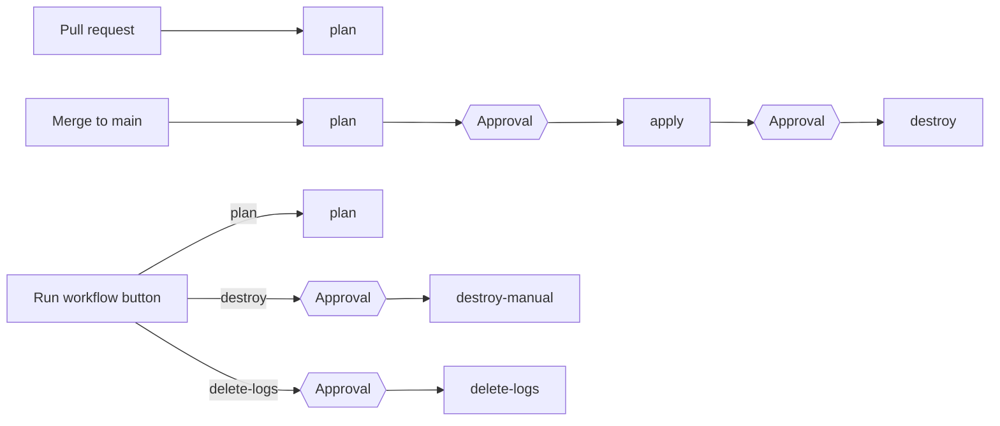

# ☁️ Terraform on AWS with GitHub Actions OIDC

Deploy AWS infrastructure from GitHub Actions **without storing any AWS keys in GitHub**.
GitHub proves who it is to AWS with a short-lived OpenID Connect (OIDC) token, and AWS hands back temporary credentials for one IAM role.

The pipeline plans on every pull request. On every merge to `main` it applies, then destroys everything after a manual approval. Each step's output also goes to CloudWatch Logs.

---

## 📑 Table of contents

1. [What gets built](#-what-gets-built)
2. [How the pipeline works](#-how-the-pipeline-works)
3. [Repository layout](#-repository-layout)
4. [Prerequisites](#-prerequisites)
5. [Setup from scratch](#-setup-from-scratch)
6. [Where the Terraform state is stored](#-where-the-terraform-state-is-stored)
7. [GitHub settings](#-github-settings)
8. [Manual approval](#-manual-approval)
9. [Manual actions: plan, destroy, delete logs](#-manual-actions-plan-destroy-delete-logs)
10. [What to change for your project](#-what-to-change-for-your-project)
11. [How the workflow file was kept short](#-how-the-workflow-file-was-kept-short)
12. [Secrets read by the pipeline](#-secrets-read-by-the-pipeline)
13. [CloudWatch pipeline logs](#-cloudwatch-pipeline-logs)
14. [Troubleshooting](#-troubleshooting)
15. [Security notes](#-security-notes)
16. [Cleaning up](#-cleaning-up)

---

## 🧱 What gets built

The project has two Terraform stacks. You run each one in a different way.

| Stack | Folder | Who runs it | What it creates |
|---|---|---|---|
| **Bootstrap** | `terraform/bootstrap` | You, **once**, from your machine with admin credentials | The IAM role GitHub assumes, its trust policy and permissions, and optionally the GitHub OIDC provider |
| **Prod** | `terraform/environments/prod` | The GitHub Actions pipeline | S3 buckets, a Secrets Manager secret, and an EC2 instance with its IAM role and security group |

**Prod resources in detail:**

- 🪣 **S3 buckets.** One bucket per entry in `s3_buckets`, with versioning and a lifecycle rule. Names end with your account ID to keep them globally unique.
- 🔐 **Secrets Manager secret** `<project>/<environment>/app-config`. Terraform creates it with `CHANGE_ME` placeholders only. Real values are set outside Terraform.
- 🖥️ **EC2 instance.** Amazon Linux 2023 in the default VPC, with no inbound ports. You connect through SSM Session Manager. The instance can read the app secret.

---

## 🔄 How the pipeline works



| Job | Runs when | Approval | What it does |
|---|---|---|---|
| `plan` | Pull request to `main`, push to `main`, or manual run with **plan** | No | Makes sure the test secret exists, reads it, then runs the Terraform format check, init, validate and plan |
| `apply` | Push to `main`, after `plan` | ✅ Yes | Applies the saved plan |
| `destroy` | Push to `main`, after `apply` | ✅ Yes | Destroys everything in the prod stack |
| `destroy-manual` | Manual run with **destroy** | ✅ Yes | Destroys everything, without needing a new apply first |
| `delete-logs` | Manual run with **delete-logs** | ✅ Yes | Deletes the CloudWatch log group |

**What triggers a run:**

- ✅ Changes under `terraform/` or `scripts/`, or to the workflow file itself.
- 🚫 **README changes never trigger a run.** The trigger excludes `README.md` anywhere in the repository, so documentation edits don't start a deploy. A commit that changes Terraform code *and* a README still runs, because of the Terraform change.
- 🔘 The **Run workflow** button, at any time.

**How the AWS login works:**

1. The job asks GitHub for an OIDC token, which the `id-token: write` permission allows.
2. `aws-actions/configure-aws-credentials` sends the token to AWS STS together with the role ARN.
3. AWS checks the token against the role's trust policy: the right audience and an allowed repository, branch or environment.
4. AWS returns credentials that expire after at most one hour. No AWS key is ever stored in GitHub.

---

## 📂 Repository layout

```text
.
├── .github/workflows/
│   └── terraform-prod.yml      # The pipeline: job setup plus one-line script calls
├── scripts/                    # All step logic lives here
│   ├── terraform.sh            # terraform plan | apply | destroy
│   ├── ensure-secrets.sh       # Creates the test secret or fills missing keys
│   ├── read-secrets.sh         # Reads the test secret, prints length and hash
│   ├── run-logged.sh           # Runs a script and sends its output to CloudWatch
│   └── delete-log-group.sh     # Deletes the CloudWatch log group
├── terraform/
│   ├── bootstrap/              # Run once, locally: IAM role for GitHub Actions
│   ├── environments/prod/      # Run by the pipeline: the real infrastructure
│   └── modules/
│       ├── github-oidc/        # OIDC provider, IAM role, trust policy, permissions
│       ├── s3/                 # Versioned bucket with lifecycle rules
│       ├── secrets-manager/    # Secret with placeholder keys
│       └── ec2/                # Instance, IAM role for SSM, security group
├── .gitattributes              # Keeps Unix line endings on *.sh files
└── .gitignore                  # Ignores .terraform/, state files and plan files
```

---

## 🧰 Prerequisites

| Tool or access | Version | Why |
|---|---|---|
| AWS account | – | Admin access for the one-time bootstrap |
| [Terraform](https://developer.hashicorp.com/terraform/install) | **1.10 or newer** | Native S3 state locking needs 1.10. The pipeline uses 1.10.5. |
| [AWS CLI](https://docs.aws.amazon.com/cli/latest/userguide/getting-started-install.html) | v2 | Bootstrap, the state bucket, and the scripts |
| Git and a GitHub repository | – | The pipeline runs in GitHub Actions |
| Bash and `jq` | Bash 5 | Only if you run the scripts locally. GitHub runners already have both. |

Check your AWS login before you start:

```bash
aws sts get-caller-identity
```

---

## 🚀 Setup from scratch

### Step 1 · Fork or clone the repository

```bash
git clone https://github.com/<your-user>/<your-repo>.git
cd <your-repo>
```

### Step 2 · Create the S3 bucket for Terraform state

Terraform does **not** create this bucket. It has to exist before the first `terraform init`.
Bucket names are global, so choose your own name.

```bash
BUCKET=my-terraform-state-bucket   # change this
REGION=us-west-2                   # change this

aws s3api create-bucket --bucket "$BUCKET" --region "$REGION" \
  --create-bucket-configuration LocationConstraint="$REGION"
aws s3api put-bucket-versioning --bucket "$BUCKET" \
  --versioning-configuration Status=Enabled
aws s3api put-public-access-block --bucket "$BUCKET" \
  --public-access-block-configuration \
  BlockPublicAcls=true,IgnorePublicAcls=true,BlockPublicPolicy=true,RestrictPublicBuckets=true
```

> 💡 In `us-east-1`, leave out the `--create-bucket-configuration` line.

### Step 3 · Change the project values

Edit the files listed in [What to change for your project](#-what-to-change-for-your-project).
At minimum, set these:

- The state bucket name and region in **both** backend blocks.
- `project`, `owner` and `github_repository` in **both** `terraform.tfvars` files.

### Step 4 · Find the subject claim GitHub sends

The role's trust policy must match the `sub` claim inside GitHub's token **exactly**. GitHub uses one of two formats:

| Format | Example |
|---|---|
| Classic | `repo:octo-org/my-repo:ref:refs/heads/main` |
| With immutable IDs | `repo:octo-org@123456/my-repo@987654:ref:refs/heads/main` |

Look up your owner ID and repository ID:

```bash
curl -s https://api.github.com/repos/<owner>/<repo> | jq '{owner_id: .owner.id, repo_id: .id}'
```

- **If your repository uses the ID format**, set `github_subject_repository = "<owner>@<owner_id>/<repo>@<repo_id>"` in `terraform/bootstrap/terraform.tfvars`.
- **If it uses the classic format**, delete that line. Terraform then uses `github_repository`.

Not sure which one applies? Try the classic format first. If the pipeline fails with `Not authorized to perform sts:AssumeRoleWithWebIdentity`, CloudTrail shows the exact claim. See [Troubleshooting](#-troubleshooting).

> ⚠️ Write `github_repository` as `owner/repo`, **without** a `.git` suffix.

### Step 5 · Run the bootstrap from your machine

```bash
cd terraform/bootstrap
terraform init
terraform plan
terraform apply
terraform output github_actions_role_arn
```

Copy the role ARN from the last command. You need it in the next step.
Bootstrap state goes to the S3 bucket, not your machine. See [Where the Terraform state is stored](#-where-the-terraform-state-is-stored).

> 💡 If your AWS account already has the GitHub OIDC provider `token.actions.githubusercontent.com`, set `create_oidc_provider = false`. An account can only have one.

### Step 6 · Configure GitHub

Follow [GitHub settings](#-github-settings). In short:

1. Add the repository variable `AWS_ROLE_ARN`.
2. Create the `prod` environment with **required reviewers**.

### Step 7 · Push and watch the first run

```bash
git add .
git commit -m "Configure project"
git push origin main
```

Open the **Actions** tab. `plan` runs on its own. `apply` and `destroy` each wait for your approval.

---

## 💾 Where the Terraform state is stored

Both stacks keep their state **in the S3 bucket, not on your machine**. Running bootstrap locally does not create a local state file, because `terraform/bootstrap/versions.tf` has an S3 backend block.

| Stack | State file | Set in |
|---|---|---|
| Bootstrap | `s3://<bucket>/prod/terraform-lock/bootstrap/terraform.tfstate` | `terraform/bootstrap/versions.tf` |
| Prod | `s3://<bucket>/prod/terraform-lock/terraform.tfstate` | `terraform/environments/prod/backend.tf` |

In this repository the bucket is `remote-test-sushant` in `us-west-2`.

**What you see locally after `terraform init`:**

- `terraform/bootstrap/.terraform/` holds the downloaded AWS provider and a small `terraform.tfstate`. That small file only records **which backend to use**. It does not contain your resources.
- `.terraform.lock.hcl` pins the provider versions. **Commit this file.**
- The `.terraform/` folder is in `.gitignore`. **Never commit it.** The provider binary alone is about 800 MB, and GitHub rejects files over 100 MB.

**Locking:** while a command runs, Terraform writes a lock file next to the state, for example `terraform.tfstate.tflock`. This uses `use_lockfile = true`, so no DynamoDB table is needed. Terraform deletes the lock when the command finishes.

**Check the state files:**

```bash
aws s3 ls s3://<bucket>/prod/terraform-lock/ --recursive
```

> ⚠️ If you remove the `backend "s3"` block from `versions.tf`, bootstrap state goes into a local `terraform/bootstrap/terraform.tfstate` file instead. Don't do that. Losing that file means Terraform loses track of the IAM role, and a local state file is easy to commit by mistake.

> 🔐 The pipeline role can read and write everything under `state_prefix`, which is `prod/terraform-lock`. That includes the bootstrap state. To keep bootstrap state away from the pipeline, give it a key outside that prefix.

---

## 🐙 GitHub settings

### 🔑 Repository variable: `AWS_ROLE_ARN`

**Settings → Secrets and variables → Actions → Variables tab → New repository variable**

| Name | Value |
|---|---|
| `AWS_ROLE_ARN` | The `github_actions_role_arn` output from bootstrap, for example `arn:aws:iam::123456789012:role/sushant-app-prod-github-actions` |

> ⚠️ Add it as a **repository** variable, not an environment variable. The `plan` job has no environment, so it can't see environment variables.
> It is a *variable*, not a *secret*. A role ARN isn't sensitive, and no AWS keys are stored anywhere.

### 🌍 Environment: `prod`

**Settings → Environments → New environment → `prod`**

| Setting | Value | Why |
|---|---|---|
| **Required reviewers** | ✅ Your account or your team | Gives `apply` and `destroy` their approval button. See [Manual approval](#-manual-approval). |
| Prevent self-review | ☐ Leave unticked if you approve your own runs | Otherwise nobody can approve a run they started |
| Deployment branches and tags | `main` only | Only `main` can deploy |

### ⚡ Actions permissions

**Settings → Actions → General**

- **Actions permissions:** allow `actions/*`, `aws-actions/*` and `hashicorp/*`. "Allow all actions" also works.
- **Workflow permissions:** the default, read repository contents, is enough. The workflow asks for the extra permissions it needs, including `id-token: write`.

### 🪪 OIDC subject claim

Leave GitHub's OIDC subject claim customization at its default. If you change it, update `github_subject_repository` and the trust policy to match.

---

## ✅ Manual approval

Approval comes from **GitHub Environments**. Every job with `environment: prod` pauses until a required reviewer approves it.

| Job | Uses `prod` | Waits for approval |
|---|---|---|
| `plan` | No | Never |
| `apply` | Yes | ✅ |
| `destroy` | Yes | ✅ |
| `destroy-manual` | Yes | ✅ |
| `delete-logs` | Yes | ✅ |

**How to approve a waiting job:**

1. Open the run in the **Actions** tab. A yellow **Waiting for review** banner appears.
2. Click **Review deployments**.
3. Tick **prod**, add a comment if you like, and click **Approve and deploy**. **Reject** cancels the job.

**Good to know:**

- ⚠️ **No reviewers means no approval.** If `prod` has no required reviewers, the jobs start straight away.
- ⏳ **Pending approvals expire after 30 days.** If nobody approves the destroy, your resources stay up and keep costing money.
- 💳 **Required reviewers are free on public repositories.** Private repositories need a paid GitHub plan.
- 🔁 **`apply` and `destroy` share one environment**, so the same people approve both. For separate approvers, create a second environment and add it to `allowed_environments` in `terraform/bootstrap/main.tf`, then run bootstrap again. The trust policy only accepts environments listed there.

---

## 🔘 Manual actions: plan, destroy, delete logs

**Actions → terraform-prod → Run workflow**, then pick an action:

| Action | What happens |
|---|---|
| `plan` (default) | Runs the plan only |
| `destroy` | Destroys the prod stack immediately, after approval. Useful when an apply failed partway and the automatic destroy never ran. |
| `delete-logs` | Deletes the `test_group` log group and all its streams, after approval. **This cannot be undone.** The next run creates a fresh, empty group. |

`destroy` and `delete-logs` only run from the `main` branch.

> 💡 GitHub shows the **Run workflow** button only once the workflow file is on the default branch.

---

## 📝 What to change for your project

### 📄 `terraform/bootstrap/terraform.tfvars`

| Variable | Example | Notes |
|---|---|---|
| `aws_region` | `us-west-2` | Region for bootstrap resources. Must match `LOG_REGION` in the workflow. |
| `project` | `sushant-app` | Prefix for all names. **Must match the prod tfvars.** |
| `environment` | `prod` | Part of the role name, and the GitHub environment allowed to deploy |
| `owner`, `cost_center` | `sushant`, `engineering` | Tags only |
| `github_repository` | `owner/repo` | No `.git` suffix |
| `github_subject_repository` | `owner@111/repo@222` | Only if GitHub sends the ID format. See Step 4 of the setup. |
| `create_oidc_provider` | `false` | Use `true` if your account doesn't have the GitHub OIDC provider yet |

### 📄 `terraform/bootstrap/variables.tf` (defaults you can override in tfvars)

| Variable | Default | Notes |
|---|---|---|
| `state_bucket` | `remote-test-sushant` | **Change this** to your state bucket |
| `state_prefix` | `prod/terraform-lock` | Folder in the bucket the pipeline may access. It must contain the prod state key. |
| `pipeline_log_group_name` | `test_group` | Log group named in the pipeline's log policy. Keep it equal to `LOG_GROUP`. |

### 📄 `terraform/bootstrap/main.tf`

| Setting | Default | Notes |
|---|---|---|
| `allowed_branches` | `["main"]` | Branches whose runs may assume the role |
| `allowed_environments` | `[var.environment]` | GitHub environments whose jobs may assume the role |
| `allow_pull_requests` | `true` | Lets pull-request runs assume the role for `plan` |

### 📄 Backend blocks: `terraform/bootstrap/versions.tf` and `terraform/environments/prod/backend.tf`

| Setting | Change to |
|---|---|
| `bucket` | Your state bucket |
| `key` | A path inside `state_prefix` |
| `region` | Your bucket's region |

> ⚠️ Backend blocks can't use variables. Edit the values directly in both files.

### 📄 `terraform/environments/prod/terraform.tfvars`

| Variable | Example | Notes |
|---|---|---|
| `aws_region` | `us-west-2` | **Where your resources are created** |
| `project`, `environment`, `owner`, `cost_center`, `github_repository` | – | Same values as bootstrap |
| `extra_tags` | `{ DataClassification = "internal" }` | Extra tags on every resource |
| `s3_buckets` | `app-data`, `logs` | One bucket per key. `noncurrent_version_expiration_days` is optional. |
| `secret_keys` | `DB_HOST`, `DB_PASSWORD`, … | Keys created with `CHANGE_ME` values |
| `instance_type` | `t3.micro` | EC2 size |
| `associate_public_ip` | `false` | Keep `false`. Use SSM to connect. |
| `root_volume_size` | `20` | Disk size in GB |
| `ingress_rules` | `[]` | Inbound rules. Empty means no open ports. |
| `vpc_id`, `subnet_id` | `null` | Leave `null` to use the default VPC |

### 📄 `.github/workflows/terraform-prod.yml` (the `env:` block)

| Variable | Default | Notes |
|---|---|---|
| `TF_VERSION` | `1.10.5` | Terraform version on the runner |
| `AWS_REGION` | `us-east-1` | Region for the AWS login and the test secret. Prod resources use `aws_region` from tfvars instead. |
| `WORKDIR` | `terraform/environments/prod` | Terraform folder the pipeline runs in |
| `SECRET_ID` | `sushant-app/prod/ci-test-keys` | Test secret the pipeline creates and reads |
| `LOG_GROUP` | `test_group` | CloudWatch log group for pipeline logs |
| `LOG_REGION` | `us-west-2` | Region of the log group |
| `LOG_RETENTION_DAYS` | `30` | Days to keep logs. Applied on every run. |

The trigger `paths` near the top of the same file decide which changes start a run. Add a `!` pattern to ignore more files, the same way README files are ignored.

### 📄 `scripts/`

| File | What to change |
|---|---|
| `ensure-secrets.sh` | Default values, set through `DEFAULT_AWS_ACCESS_KEY` and `DEFAULT_AWS_SECRET_KEY`, and the key names inside `DEFAULTS` |
| `read-secrets.sh` | The `KEYS` list, if you rename or add keys |
| `terraform.sh` | `DESTROY_DELAY_SECONDS` adds an optional wait before destroy. The default is `0`. |

### 📄 `terraform/modules/github-oidc/variables.tf`

| Variable | Default | Notes |
|---|---|---|
| `managed_policy_arns` | `PowerUserAccess` | Broad on purpose for a demo. **Narrow it** for real projects. |

---

## 📉 How the workflow file was kept short

**The idea:** the workflow only *sets up* each job. Everything a job *does* lives in a script under `scripts/`.

**Before**, logic sat inline in the YAML and was repeated across jobs:

```yaml
- name: Read secrets from AWS Secrets Manager
  run: |
    secret_json=$(aws secretsmanager get-secret-value --secret-id "$SECRET_ID" ...)
    for key in AWS_ACCESS_KEY AWS_SECRET_KEY; do
      value=$(echo "$secret_json" | jq -r --arg k "$key" '.[$k] // empty')
      ...
    done
- run: terraform fmt -check -recursive ../..
- run: terraform init -input=false
- run: terraform validate
- run: terraform plan -input=false -out=tfplan
```

**After**, every step is one line:

```yaml
- name: Read secrets
  run: bash "$SCRIPTS/run-logged.sh" read-secrets.sh
- name: Terraform plan
  run: bash "$SCRIPTS/run-logged.sh" terraform.sh plan
```

**What changed:**

- 📜 **Inline `run:` blocks moved into scripts.** `terraform.sh` takes the stage as an argument, `plan`, `apply` or `destroy`, so three jobs share one script.
- 📁 **No `working-directory` blocks.** The scripts find the Terraform folder from `WORKDIR`, relative to the repository root.
- 🪵 **Logging is one wrapper.** `run-logged.sh` runs any script and sends its output to CloudWatch, so no job needs its own logging code.
- 🔁 **Settings live in one place.** The top-level `env:` block feeds every job and script.

That first refactor took the file from 135 to 99 lines. Later additions, the approval gates, the manual destroy and delete-logs, each added a short job but no inline logic.

**What has to stay in YAML:** steps that use a GitHub action with `uses:`, such as checkout, the AWS login, Terraform setup and the plan upload, can't run from a shell script.

**Benefits:**

- ✅ **Scripts run locally.** You can test a step without pushing.
- ✅ **Changes stay small.** Editing a step means editing one script.
- ✅ **Script changes trigger the pipeline**, because `scripts/**` is in the trigger paths.

> 💡 Windows users: `.gitattributes` forces Unix line endings on `*.sh`. Windows line endings would break the scripts on the Linux runner.

---

## 🔐 Secrets read by the pipeline

The `plan` job shows how to read values from AWS Secrets Manager. The secret `SECRET_ID` holds two **test** keys, `AWS_ACCESS_KEY` and `AWS_SECRET_KEY`.

1. **`ensure-secrets.sh`** creates the secret if it's missing, restores it if it's scheduled for deletion, and adds any missing keys with default values. It never overwrites a value that exists.
2. **`read-secrets.sh`** reads both keys and prints their **length and SHA-256 hash**. GitHub shows `***` wherever a value would appear.

**Check that the right value arrived** by comparing hashes:

```bash
printf '%s' 12345 | sha256sum
# 5994471abb01112afcc18159f6cc74b4f511b99806da59b3caf5a9c173cacfc5
```

**Change a value:**

```bash
aws secretsmanager put-secret-value --region us-east-1 \
  --secret-id sushant-app/prod/ci-test-keys \
  --secret-string '{"AWS_ACCESS_KEY":"new","AWS_SECRET_KEY":"new"}'
```

> 📌 This secret is created **outside** Terraform on purpose, so the destroy job never deletes it.
> 📌 The app secret `<project>/<environment>/app-config` is a different secret. Terraform manages it, and it's deleted on every destroy.

---

## 📊 CloudWatch pipeline logs

`run-logged.sh` sends each script's output to the log group `LOG_GROUP`, with **one log stream per process**:

```text
test_group
├── <run-id>-<attempt>/plan/ensure-secrets
├── <run-id>-<attempt>/plan/read-secrets
├── <run-id>-<attempt>/plan/terraform-plan
├── <run-id>-<attempt>/apply/terraform-apply
├── <run-id>-<attempt>/destroy/terraform-destroy
└── <run-id>-<attempt>/destroy-manual/terraform-destroy
```

**Behaviour:**

- 🏗️ **Creates the log group on first use**, so no Terraform apply is needed.
- 🗓️ **Sets retention from `LOG_RETENTION_DAYS` on every run.** Change the number in the workflow and the next run updates the group.
- 🧹 **Removes color codes** and keeps each line's timestamp.
- 🙈 **Never sends `::add-mask::` lines.** Those lines contain raw secret values, and CloudWatch masks nothing.
- 🛟 **Never fails a step because of logging.** A failed upload prints a warning, and the step keeps its own result.

**Read the logs:**

```bash
aws logs tail test_group --region us-west-2 --follow
```

Or open **CloudWatch → Log groups → test_group** in the AWS console.

Steps that use a GitHub action, such as checkout and setup, are not captured. Their logs stay in GitHub only.

---

## 🩺 Troubleshooting

| Symptom | Cause | Fix |
|---|---|---|
| `Not authorized to perform sts:AssumeRoleWithWebIdentity` | The trust policy doesn't match the token's `sub` claim | Check CloudTrail for the exact claim, using the command below. Remove any `.git` suffix from `github_repository`, set `github_subject_repository` if needed, and run bootstrap again. |
| VS Code says "Can't push refs to remote. Try running Pull first" | Usually a commit contains a file over 100 MB, such as the provider binary in `.terraform/` | Undo the commit with `git reset --soft HEAD~1`, unstage `.terraform/`, and check `.gitignore` |
| `Saved plan is stale` | The state changed after the plan was made | Run `terraform plan` again. If it shows no changes, there's nothing to apply. |
| `You can't create this secret because a secret with this name is already scheduled for deletion` | An earlier destroy used a recovery window | Delete it for good with the command below. The code now sets `recovery_window_in_days = 0`, so this shouldn't come back. |
| `The specified log group does not exist` warning | Old script version | Pull the latest `scripts/run-logged.sh`, which creates the group itself |
| No approval button appears | `prod` has no required reviewers | See [Manual approval](#-manual-approval) |
| No **Run workflow** button | The workflow isn't on the default branch yet | Merge it to `main` |
| A README edit started a run | Old trigger paths | Pull the latest workflow, which ignores `README.md` |

**Find the exact subject claim GitHub sent:**

```bash
aws cloudtrail lookup-events --region us-east-1 \
  --lookup-attributes AttributeKey=EventName,AttributeValue=AssumeRoleWithWebIdentity \
  --max-results 5 --query 'Events[].CloudTrailEvent' --output text \
  | grep -o '"userName":"[^"]*"'
```

Use the region from `AWS_REGION` in the workflow.

**Delete a secret that is scheduled for deletion:**

```bash
aws secretsmanager delete-secret --region <aws_region> \
  --secret-id <project>/<environment>/app-config --force-delete-without-recovery
```

---

## 🔒 Security notes

- 🚫 **No AWS keys in GitHub.** The pipeline uses short-lived OIDC credentials only.
- 🎯 **The trust policy is narrow.** Only this repository's `main` branch, its pull requests and the `prod` environment can assume the role.
- 🧾 **IAM changes are scoped.** The pipeline may only manage IAM roles and instance profiles whose names start with `project`.
- ⚠️ **`PowerUserAccess` is broad.** Replace it with least-privilege policies in `managed_policy_arns` for real projects.
- 🔑 **No secret values in code.** Values never go in tfvars. The app secret starts with placeholders that you fill in by hand.
- 🧪 **`12345` is a placeholder.** The test keys are not real credentials. Never put real keys in the scripts.
- 🙈 **Masked values stay out of CloudWatch.** The logging wrapper drops `::add-mask::` lines before upload.

---

## 🧹 Cleaning up

1. **Destroy the prod resources.** Run the workflow with **destroy** and approve it.
2. **Delete the pipeline logs.** Run the workflow with **delete-logs** and approve it.
3. **Delete the test secret:**
   ```bash
   aws secretsmanager delete-secret --region us-east-1 \
     --secret-id sushant-app/prod/ci-test-keys --force-delete-without-recovery
   ```
4. **Remove the bootstrap role** from your machine:
   ```bash
   cd terraform/bootstrap
   terraform destroy
   ```
5. **Delete the state bucket** if nothing else uses it. Empty it first, including old versions.

---

## 📜 License

See [LICENSE](LICENSE).
